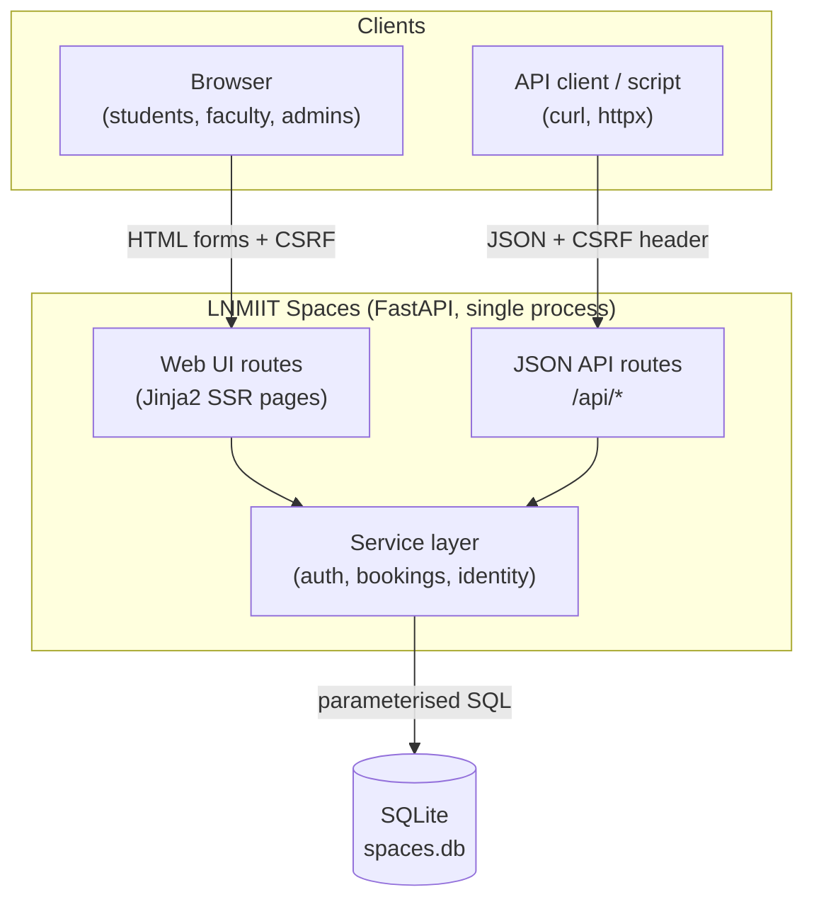
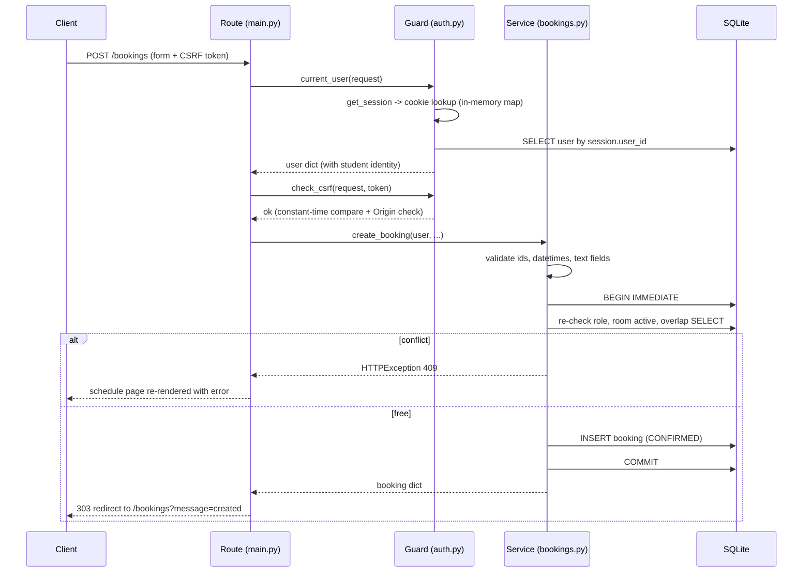
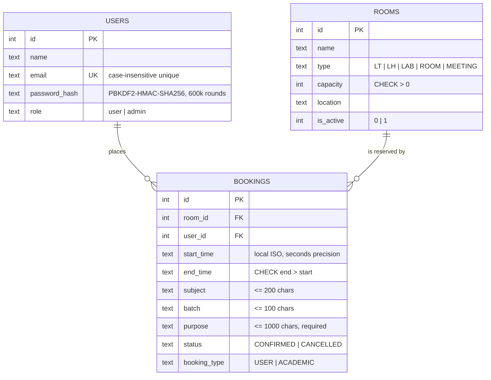

# High-Level Design (HLD)

**Project:** LNMIIT Spaces — Room Discovery & Booking System
**Institution:** The LNM Institute of Information Technology (LNMIIT), Jaipur
**Document status:** v1.0
**Audience:** Project guide, reviewers, future maintainers

---

## 1. Introduction

### 1.1 Purpose of this document

This High-Level Design describes the architecture of **LNMIIT Spaces** at a system level: the problem context, functional overview, module decomposition, data architecture, key flows, security design, and the deliberate engineering trade-offs. It is intended to be read before the [Low-Level Design](LLD.md); together they explain *what* the system does and *how* it is realised in code.

### 1.2 Scope

LNMIIT Spaces is a web application that lets the campus community:

- **Discover** bookable spaces — lecture theatres (LT), lecture halls (LH), labs (LAB), study rooms (ROOM), and meeting rooms (MEETING) — filtered by type and minimum capacity.
- **View daily schedules** of confirmed bookings for any active room.
- **Book** rooms with subject, batch, and purpose metadata, with automatic double-booking prevention.
- **Cancel** their own bookings; admins may cancel any booking.
- **Administer** the room inventory (create, edit, activate/deactivate) and block **academic slots** that override user bookings.
- **Consume a JSON REST API** mirroring the read/write operations for programmatic use.

Out of scope: recurring bookings, waitlists, email notifications, payments, and central institute SSO integration (see §9).

### 1.3 Definitions

| Term | Meaning |
|---|---|
| Room type | One of `LT`, `LH`, `LAB`, `ROOM`, `MEETING` |
| Booking | A time-bound reservation of a room; `CONFIRMED` or `CANCELLED` |
| Booking type | `USER` (self-service) or `ACADEMIC` (admin-imposed timetable block) |
| Campus time | Asia/Kolkata, fixed UTC+5:30, no DST |
| Session | Server-side auth state keyed by a 256-bit random cookie value |

---

## 2. System Overview

### 2.1 Context

The system is a **monolithic, server-rendered application**. One ASGI process serves both the human-facing HTML pages and the machine-facing JSON API over the same domain, sharing a single service layer and database. This is intentional: for a single-campus deployment with a bounded user base, a monolith minimises operational surface while keeping the code auditable end-to-end.

### 2.2 Product capabilities

| Capability | Description | Who |
|---|---|---|
| Room discovery | Filter active rooms by type and minimum capacity | Everyone |
| Daily schedule | Confirmed bookings for a room on a chosen day | Everyone |
| Create booking | Purpose-required reservation with conflict detection | Signed-in users |
| Cancel booking | Own `USER` bookings; admins cancel anything | Users / Admins |
| Room inventory | Add/edit rooms, toggle active state | Admins |
| Academic blocking | Create `ACADEMIC` bookings (admin-only type) | Admins |
| Account creation | CLI tool provisioning users and admins | Operator |

---

## 3. Architecture

### 3.1 Layered view

```mermaid
flowchart LR
    subgraph L1["Presentation"]
        T["Jinja2 templates<br/>(base, rooms, schedule, bookings, admin, login, error)"]
        CSS["static/style.css<br/>hand-rolled design system"]
    end
    subgraph L2["Interface / routing"]
        M["main.py<br/>pages + REST API + error handlers"]
    end
    subgraph L3["Business logic"]
        AU["auth.py<br/>sessions, CSRF, password hashing"]
        BK["bookings.py<br/>booking & room rules, transactions"]
        SI["student_identity.py + coursecatalog.py<br/>roll-number decoding"]
        CU["create_user.py<br/>CLI provisioning"]
    end
    subgraph L4["Data access"]
        CN["connection.py<br/>connections, queries, schema setup"]
        SC["schema.sql<br/>tables, checks, index"]
    end
    DB[("SQLite file")]
    L1 --> L2 --> L3 --> L4 --> DB
```

Dependencies point strictly downward. `main.py` never issues SQL directly; `bookings.py` and `auth.py` encapsulate every statement they need; `connection.py` is the only module that owns connection settings and seed data.

### 3.2 Module responsibilities

| Module | Responsibility | Key exports |
|---|---|---|
| `main.py` | Route definitions, request parsing, page rendering, API serialisation, error handlers | FastAPI `app`, page handlers, `/api/*` handlers |
| `auth.py` | Password hashing/verification, session lifecycle, cookies, CSRF, role guards | `hash_password`, `verify_password`, `new_session`, `get_session`, `get_user`, `current_user`, `admin_user`, `check_csrf` |
| `bookings.py` | Booking creation/cancellation/listing, room save/list, input validation, transaction boundaries | `create_booking`, `cancel_booking`, `list_bookings`, `save_room`, `all_rooms` |
| `connection.py` | SQLite connections (PRAGMAs, timeout), room listing/schedule queries, first-run schema + seed | `get_connection`, `list_rooms`, `room_schedule`, `setup_database`, `room_types` |
| `student_identity.py` | Parses `@lnmiit.ac.in` emails into roll number, programme, branch, school | `student_identity` |
| `coursecatalog.py` | Static LNMIIT programme/branch catalog with evidence sources | `programmes`, `branch_names` |
| `create_user.py` | Interactive CLI account creator with password policy | `create_user`, `main` |

### 3.3 Request flow

---

## 4. Data Architecture

### 4.1 Entity-relationship model

Design decisions:

- **Datetimes are stored as campus-local ISO-8601 text without offset.** The campus runs a fixed UTC+5:30 with no DST, so a naive local representation avoids conversion bugs at the cost of portability — an accepted trade for this deployment.
- **Cancellation is a state change, not a delete.** `CANCELLED` rows preserve history and audit context; overlap checks only match `CONFIRMED`.
- **Enforcement is layered.** The schema (`CHECK` constraints, FKs, `COLLATE NOCASE` uniqueness) is the last line of defence behind service-layer validation; both exist on purpose.
- A composite index `booking_room_time (room_id, status, start_time, end_time)` backs the overlap query that guards every insert.

### 4.2 Overlap detection (invariant)

Two intervals `[s1, e1)` and `[s2, e2)` conflict iff `s1 < e2 AND e1 > s2`. Every booking insert runs this predicate against all `CONFIRMED` rows of the room **inside a `BEGIN IMMEDIATE` transaction**, so a write transaction serialises concurrent attempts and rejects the loser with `409`. This is the system's core correctness invariant.

### 4.3 Seed and lifecycle

On first run (empty database), `setup_database()` applies `schema.sql` and inserts five demo rooms (LT 180, LH 80, LAB 40, ROOM 12, MEETING 20). Accounts are never seeded; they are created via `python -m app.create_user`. The database path is controlled by `SPACES_DB`.

---

## 5. Security Design

Security is a first-class requirement, not a retrofit. The design assumes a hostile client and validates every input on the server.

| Concern | Design |
|---|---|
| Password storage | PBKDF2-HMAC-SHA256, 600,000 rounds, 128-bit per-user salt, format `rounds$salt$hash`, constant-time comparison |
| Account enumeration | Unknown emails still run a dummy 600k-round derivation, so login timing does not reveal account existence |
| Session management | 256-bit random IDs (`secrets.token_urlsafe(32)`) held **server-side**; the client only carries an opaque cookie. 10-hour authenticated lifetime, 1-hour anonymous, expiry sweeping, 4096-session cap with oldest-expiry eviction |
| Session fixation | A fresh session ID is minted at every successful login |
| Cookies | `HttpOnly`, `SameSite=Lax`, `Secure` (auto under HTTPS or `SPACES_SECURE_COOKIE=1`) |
| CSRF | Per-session token rendered into every form (and `<meta>` for the API), verified with `secrets.compare_digest`, plus same-`Origin` enforcement when the header is present |
| SQL injection | 100% parameterised queries; no string interpolation into SQL |
| Concurrency corruption | Writes wrapped in `BEGIN IMMEDIATE`; `BUSY`/`LOCKED` surfaced as HTTP `503` rather than silent failure |
| Clickjacking / sniffing | `X-Frame-Options: DENY`, `X-Content-Type-Options: nosniff` on every response |
| Information leakage | `Cache-Control: no-store` + `Vary: Cookie` on all pages and personalised API responses |
| Input abuse | Bounded field lengths, strict ID/date/datetime parsing, `max_fields` caps on form parsing, Pydantic `extra="forbid"` on API bodies, null-byte rejection |

> [!NOTE]
> Sessions live in process memory by design. A restart signs everyone out — acceptable and even desirable for this deployment scale; the cookie is worthless after the process exits.

---

## 6. Interface Design

### 6.1 Pages (server-rendered)

| Route | Page | Access |
|---|---|---|
| `GET /` , `GET /rooms` | Room browser with type/capacity filters | Public |
| `GET /rooms/{id}/bookings?day=` | Daily schedule + booking form | Public view; sign-in to book |
| `GET /bookings` | Upcoming vs past bookings split | Signed in |
| `GET /admin` | Inventory, all bookings, academic block form | Admin |
| `GET /login` · `POST /login` · `POST /logout` | Sign in / out | Public |

### 6.2 JSON API

| Method | Endpoint | Auth | Success |
|---|---|---|---|
| `GET` | `/api/rooms?type=&min_capacity=` | — | `200` list |
| `GET` | `/api/rooms/{id}/bookings?day=` | — | `200` room + day + bookings |
| `GET` | `/api/bookings` | Session | `200` list (all bookings for admins) |
| `POST` | `/api/bookings` | Session + CSRF header | `201` booking |
| `DELETE` | `/api/bookings/{id}` | Session + CSRF header | `200` booking |

Errors are uniform `{"detail": "..."}` with meaningful status codes (`400` validation, `401` unauthenticated, `403` authz/CSRF, `404` missing/inactive, `409` conflict, `503` database busy).

### 6.3 UI conventions

One `base.html` template provides the skip link, navigation, CSRF `<meta>`, ARIA-marked notices (`role=alert` / `role=status`), and footer. Pages stay keyboard-operable, tables scroll horizontally, and the stylesheet is a single hand-rolled responsive design system with visible focus outlines.

---

## 7. Non-Functional Design

| Quality | Approach |
|---|---|
| Performance | Indexed overlap queries; per-request short-lived connections; O(1) session lookups under a lock; no ORM overhead |
| Correctness under concurrency | `BEGIN IMMEDIATE` write serialisation; overlap re-checked inside the transaction, not just in the UI |
| Availability | Single-process by design; `503` with human-readable message on database lock contention |
| Maintainability | Small modules with single responsibilities; validation helpers reused across web and API paths |
| Accessibility | Skip links, focus outlines, ARIA labels, keyboard-scrollable schedule tables, responsive layout |
| Portability | Pure Python stdlib + six pinned dependencies; SQLite means zero external services |

---

## 8. Technology Selection (summary)

| Decision | Choice | Why (high level) |
|---|---|---|
| Framework | FastAPI | Async ASGI, first-class Pydantic validation, clean separation of pages + JSON API in one process |
| Template engine | Jinja2 | Server-rendered security (CSRF flows naturally), no client-state duplication |
| Database | SQLite | Single-campus scale, zero administration, file-backed portability; `BEGIN IMMEDIATE` gives the serialisation the overlap invariant needs |
| Auth | Self-hosted sessions | No external dependency; full control of cookie flags, expiry, eviction (rationale expanded in the Project Selection Report) |
| Runtime | Uvicorn | Standard ASGI server for FastAPI with `--reload` DX |

Detailed rationale and rejected alternatives appear in the [Project Selection Report](Project%20Selection%20Report.md).

---

## 9. Constraints, Trade-offs, and Future Scope

> [!IMPORTANT]
> These are deliberate v1 constraints, each with a known evolution path.

| Constraint | Consequence | Evolution path |
|---|---|---|
| In-memory sessions | Restart logs everyone out; multi-worker deployment would not share sessions | Move session map to Redis / signed server-side store in DB |
| SQLite file | Single-writer serialisation; no horizontal scale | Swap `connection.py` for PostgreSQL — the service layer isolates SQL dialect behind one module |
| Local-time datetimes | Tied to IST semantics | Migrate columns to UTC at schema level |
| No email verification / SSO | Accounts provisioned by CLI only | Institute SSO (CAS/OIDC) integration point is `find_user` / `get_user` |
| No notifications | Users must re-check `/bookings` | Add a mailer triggered after commit |
| Demo seed rooms | Inventory must be entered by admins | Bulk CSV import in admin console |

---

## 10. Related documents

- [Low-Level Design (LLD)](LLD.md) — module-level specification, algorithms, contracts
- [Project Selection Report](Project%20Selection%20Report.md) — why this project and these technologies
- [`../README.md`](../README.md) — user-facing quick start and feature reference
