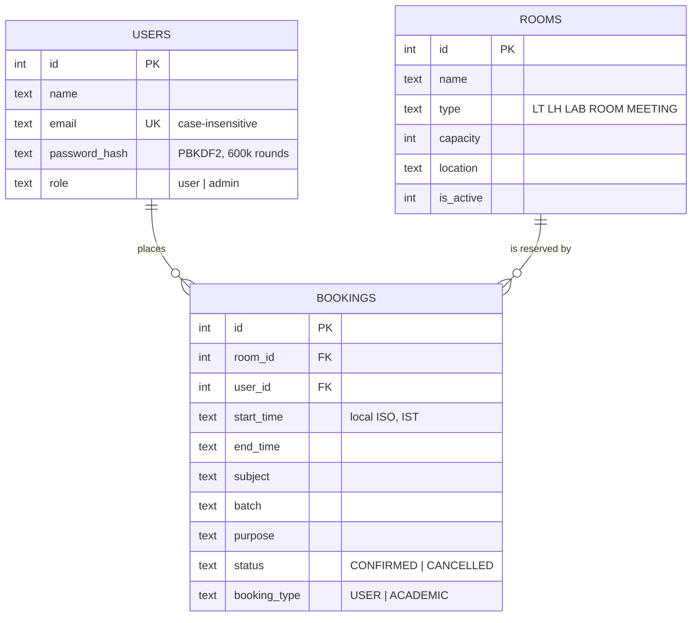
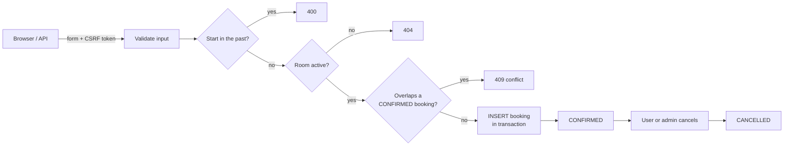

<div align="center">

# 🏛️ LNMIIT Spaces

**Room discovery & booking system for The LNM Institute of Information Technology**

Browse campus spaces, check daily schedules, and book lecture theatres, labs, and meeting rooms — with a full admin console for room inventory and academic slot blocking.


</div>

---

## ✨ Features

| Feature | Description |
|---|---|
| 🔍 **Room discovery** | Filter active rooms by type (LT, LH, LAB, ROOM, MEETING) and minimum capacity |
| 📅 **Daily schedules** | View any room's confirmed bookings for a chosen day |
| 📝 **Bookings** | Book a room with subject, batch, and purpose; overlap detection rejects conflicts (409) |
| ❌ **Cancellations** | Users cancel their own bookings; admins can cancel anything |
| 🛠️ **Admin console** | Add/edit rooms, activate/deactivate them, block academic slots, and see all bookings |
| 🧑‍🎓 **Student identity** | Roll numbers parsed from `@lnmiit.ac.in` emails into programme, branch, and school |
| 🔐 **Hardened auth** | PBKDF2-HMAC-SHA256 (600k rounds), server-side sessions, CSRF + origin checks |
| 🌐 **JSON API** | Full read/write REST API alongside the server-rendered UI |
| ♿ **Accessible UI** | Skip links, focus outlines, ARIA labels, keyboard-scrollable schedule tables, responsive layout |

## 🧱 Tech Stack

| Layer | Choice |
|---|---|
| Framework | [FastAPI](https://fastapi.tiangolo.com) + Uvicorn (ASGI) |
| Templates | Jinja2, server-rendered HTML with a hand-rolled CSS design system |
| Database | SQLite via the standard `sqlite3` module (parameterised queries, `BEGIN IMMEDIATE` transactions) |
| Auth | In-memory sessions + HttpOnly/SameSite cookies, PBKDF2 password hashing |
| Validation | Pydantic v2 (API models) + explicit input checks in the service layer |

## 🚀 Quick Start

> [!IMPORTANT]
> Run every command from the **project root** — the folder that contains `app/`. The code imports itself as a package (`from app.auth import ...`), so running from inside `app/` will fail.

```bash
# 1. Create a virtual environment and install dependencies
python -m venv .venv
#    Windows:
.venv\Scripts\activate
#    macOS / Linux:
source .venv/bin/activate

pip install -r app/requirements.txt

# 2. Start the dev server (seeds the database + demo rooms on first run)
python -m uvicorn app.main:app --reload

# 3. Create accounts (prompts for a password of at least 12 characters)
python -m app.create_user --name "Admin" --email admin@example.com --role admin
python -m app.create_user --name "Student" --email student@example.com --role user
```

Then open **http://127.0.0.1:8000/rooms** 🎉

<details>
<summary>📦 What gets seeded on first run?</summary>

The database file (`app/data/spaces.db`) is created automatically with the schema from `schema.sql`, plus five demo rooms: Lecture Theatre 1 (LT, 180), Lecture Hall 2 (LH, 80), Computer Lab (LAB, 40), Study Room (ROOM, 12), and Meeting Room (MEETING, 20). Demo inventory only — replace it from the admin console.
</details>

## ⚙️ Configuration

| Environment variable | Default | Purpose |
|---|---|---|
| `SPACES_DB` | `app/data/spaces.db` | Path to the SQLite database file |
| `SPACES_SECURE_COOKIE` | unset | Set to `1` to force `Secure` session cookies behind HTTPS |

## 🗺️ Pages

| Route | Page | Access |
|---|---|---|
| `/` · `/rooms` | Room browser with type/capacity filters | Public |
| `/rooms/{id}/bookings` | Daily schedule + booking form for one room | Public view, sign-in to book |
| `/bookings` | Your upcoming & past bookings | Signed in |
| `/admin` | Room inventory, all bookings, academic block form | Admin |
| `/login` | Sign in / sign out | Public |

## 🔌 JSON API

| Method | Endpoint | Description | Auth |
|---|---|---|---|
| `GET` | `/api/rooms?type=&min_capacity=` | List active rooms | — |
| `GET` | `/api/rooms/{id}/bookings?day=YYYY-MM-DD` | Room + confirmed bookings for a day | — |
| `GET` | `/api/bookings` | Your bookings (all bookings for admins) | Session |
| `POST` | `/api/bookings` | Create a booking (JSON body + `X-CSRF-Token` header) | Session + CSRF |
| `DELETE` | `/api/bookings/{id}` | Cancel a booking | Session + CSRF |

<details>
<summary>🔧 Example: create a booking via the API</summary>

```bash
# 1. Sign in and keep the session cookie
curl -c cookies.txt http://127.0.0.1:8000/login -o /dev/null
TOKEN=$(curl -b cookies.txt -s http://127.0.0.1:8000/login | grep -oP 'csrf-token" content="\K[^"]+')
curl -b cookies.txt -c cookies.txt -X POST http://127.0.0.1:8000/login \
  -d "csrf_token=$TOKEN" -d "email=student@example.com" -d "password=your-password"

# 2. Book a room
TOKEN=$(curl -b cookies.txt -s http://127.0.0.1:8000/login | grep -oP 'csrf-token" content="\K[^"]+')
curl -b cookies.txt -X POST http://127.0.0.1:8000/api/bookings \
  -H "Content-Type: application/json" -H "X-CSRF-Token: $TOKEN" \
  -d '{"room_id": 1, "start_time": "2026-11-24T10:00", "end_time": "2026-11-24T11:00",
       "subject": "CSE workshop", "batch": "2024", "purpose": "Practice session"}'
```

Errors are returned as `{"detail": "..."}` with meaningful status codes — `409` for slot conflicts, `400` for invalid input, `403` for auth/CSRF failures.
</details>

## 🗄️ Database Schema



A composite index on `(room_id, status, start_time, end_time)` backs the overlap check that guards every insert.

## 🔁 Booking Lifecycle



## 🔐 Security Highlights

- **Password storage** — PBKDF2-HMAC-SHA256 with 600,000 iterations, per-user 128-bit salt, constant-time comparison
- **Timing-safe login** — unknown accounts still run a dummy hash derivation so response times don't leak which emails exist
- **Sessions** — 256-bit random IDs held server-side (never trusted from the client), expiry sweeping, 10-hour lifetime
- **CSRF** — per-session token on every mutating form/request plus same-`Origin` verification
- **Cookies** — `HttpOnly`, `SameSite=Lax`, `Secure` under HTTPS
- **Headers** — `Cache-Control: no-store`, `X-Content-Type-Options: nosniff`, `X-Frame-Options: DENY` on every page
- **SQL** — 100% parameterised queries; writes wrapped in `BEGIN IMMEDIATE` transactions with busy/locked mapped to `503`
- **Input limits** — bounded field lengths, strict ID/date/datetime parsing on both web and API paths

## 🧑‍🎓 Roll Number Decoding

Emails on `lnmiit.ac.in` / `lnmit.ac.in` are parsed into a student identity and shown in the header. For example `24UCS123@lnmiit.ac.in` → 2024 batch, B.Tech. Computer Science and Engineering (CSE school mapping). Supported prefixes cover UG (`UCC`, `UCS`, `UEC`, `UME`), dual degree (`DCS`, `DEC`, `IMAI`), PG (`MCS`, `MEC`, `MMT`, `MPH`), and PhD (`PCC`, `PCS`, `PEC`) — see `app/coursecatalog.py`.

## 📁 Project Structure

```
app/
├── main.py              # Routes, pages, API, error handlers
├── auth.py              # Sessions, cookies, CSRF, password hashing
├── bookings.py          # Booking/room business logic + transactions
├── connection.py        # SQLite connection, schema setup, seed data
├── student_identity.py  # Roll-number → programme/branch decoding
├── coursecatalog.py     # LNMIIT programme catalog data
├── create_user.py       # CLI account creator
├── schema.sql           # Tables, checks, indexes
├── requirements.txt     # Pinned dependencies
├── static/style.css     # Hand-rolled responsive design system
├── templates/           # Jinja2 pages (base, rooms, schedule, bookings, admin, login, error)
├── data/spaces.db       # SQLite database (created at runtime)
└── documentation/       # HLD, LLD, project reports
```

## 🌏 Notes

- **Timezone** — the campus runs on Asia/Kolkata (UTC+5:30, no DST); bookings are stored as campus-local ISO datetimes without offsets
- **Sessions are in-memory** — a server restart signs everyone out (by design for this deployment)
- **Admin vs. user** — only admins create `ACADEMIC` blocks and deactivate rooms; users may cancel only their own `USER` bookings

## 📚 Documentation

- [High-Level Design](HLD.md)
- [Low-Level Design](LLD.md)
- [Project Selection Report](Project%20Selection%20Report.md)

---

<div align="center">
<sub>Built with FastAPI · SQLite · Jinja2 — for the LNMIIT campus community 🐯</sub>
</div>
